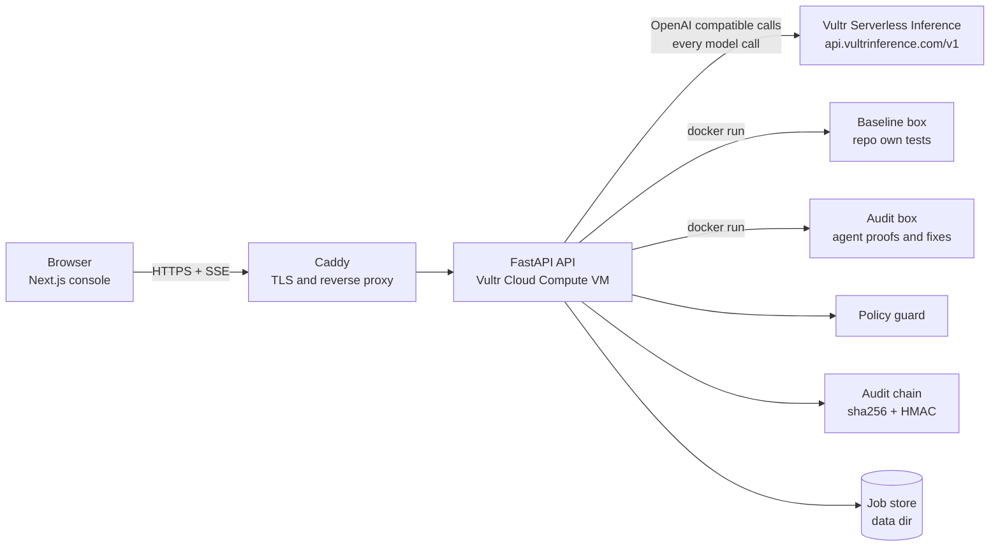
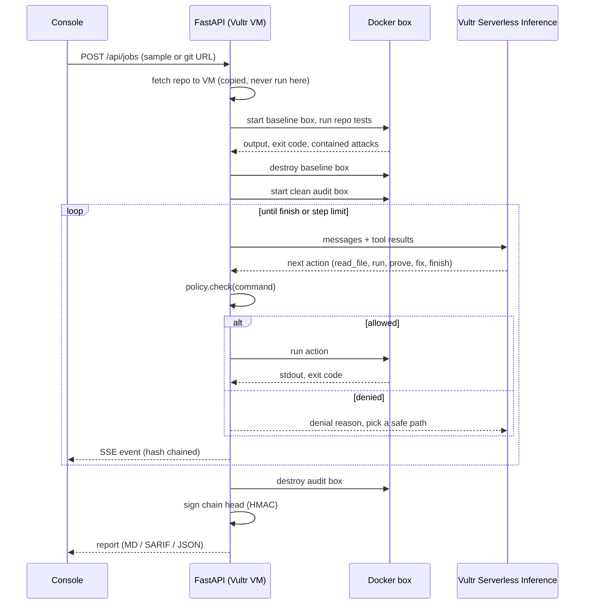
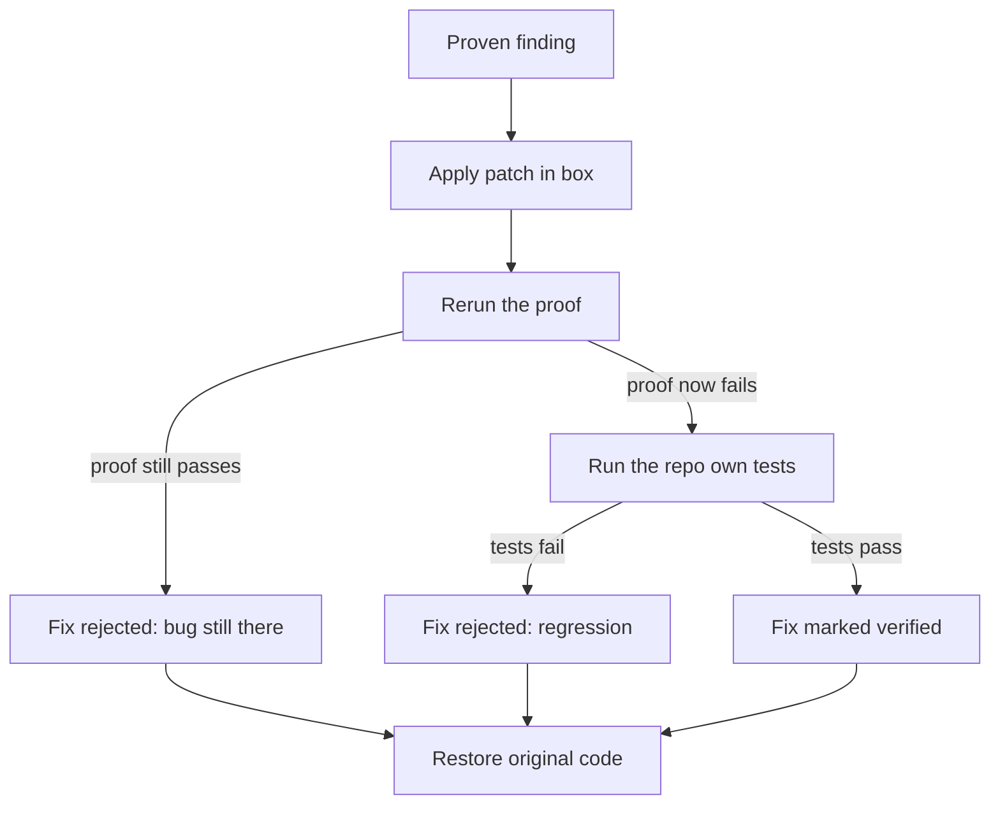

# ProofBox

**Bugs with proof, run in a box that cannot hurt you.**

Built for the **Vultr Agent Rush** hackathon (lablab.ai).
Track: *Blast Radius Zero: Safe Agent Execution on Vultr*. Pattern A: sandboxed code execution.

ProofBox is an AI code auditor. An agent reads a repository, suspects bugs, then writes an exploit test for each one and runs it inside a locked Docker sandbox on a Vultr VM. A finding only reaches the report if its proof passes in the sandbox. For each proven bug the agent also writes a patch, and ProofBox checks that the proof now fails and the repo tests still pass. No proof, no finding.

The code under audit is untrusted. The model output is untrusted too. Both only ever touch a throwaway container.

---

## Contents

1. [The problem](#the-problem)
2. [Architecture](#architecture)
3. [Vultr integration](#vultr-integration)
4. [The agent loop](#the-agent-loop)
5. [Containment model](#containment-model)
6. [Verified fixes](#verified-fixes)
7. [Command policy guard](#command-policy-guard)
8. [Tamper evident audit trail](#tamper-evident-audit-trail)
9. [API reference](#api-reference)
10. [Configuration](#configuration)
11. [Bundled samples](#bundled-samples)
12. [Demo mode and live mode](#demo-mode-and-live-mode)
13. [Run locally](#run-locally)
14. [Deploy on Vultr](#deploy-on-vultr)
15. [Tests](#tests)
16. [Project layout](#project-layout)
17. [Threat model and honest limits](#threat-model-and-honest-limits)

---

## The problem

AI code review guesses. It reports bugs that are not real and nobody can tell which ones. The fix is to run the code. But running code you do not trust is the exact risk this track is about. A hostile repo can steal secrets, phone home, wipe the disk, install persistence, or hang the host.

ProofBox solves both sides. The agent has real execution power, so its findings are proven. The execution happens in a box with zero blast radius, so a hostile repo or a confused model cannot hurt anything.

## Architecture

### System view



### One audit, end to end



### Components

| Component | Path | Role |
|---|---|---|
| Web console | `frontend/` | Next.js 15 landing page and live console. Streams events over SSE. Apple style design. |
| API | `backend/app/main.py` | FastAPI. Job lifecycle, SSE stream, report export, health. |
| Agent | `backend/app/agent.py` | The tool loop. Proof and fix logic. |
| LLM client | `backend/app/llm.py` | OpenAI compatible client pointed at Vultr Serverless Inference. |
| Sandbox | `backend/app/sandbox.py` | Docker lifecycle, hardening flags, timeouts, cleanup. |
| Policy | `backend/app/policy.py` | Regex rules that deny risky commands before they run. |
| Audit | `backend/app/audit.py` | Hash chain, HMAC signature, report builders. |
| Jobs | `backend/app/jobs.py` | Job state, event log, chain linking. |
| Sources | `backend/app/sources.py` | Fetches a sample or a public git repo, size capped. |
| Demo plans | `backend/app/demo_plans.py` | Scripted agent for keyless demo mode. |
| Sandbox image | `sandbox/Dockerfile` | Python, Node, Foundry, solc. No network at run time. |
| Deploy | `deploy/` | Setup script, systemd units, Caddyfile, orphan sweeper. |

## Vultr integration

ProofBox uses Vultr for the two things the track asks for.

**1. Vultr Cloud Compute (the VM).** The whole backend runs on one Vultr VM: the API, the agent loop and the Docker sandbox. `deploy/setup-vultr.sh` installs Docker, builds the sandbox image, installs systemd services, sets up Caddy for HTTPS and opens only SSH and web in the firewall. The sandbox boundary is Docker on this VM.

**2. Vultr Serverless Inference (every model call).** All agent reasoning goes through the OpenAI compatible endpoint:

```
base url : https://api.vultrinference.com/v1
auth     : Authorization: Bearer $VULTR_INFERENCE_API_KEY
model    : PROOFBOX_MODEL (default kimi-k2-instruct)
```

The client lives in `backend/app/llm.py`. `GET /api/models` lists the model ids the account can use, so the model can be set without guessing. The key is read from the server environment only. It is never sent to the browser and never placed inside a sandbox.

## The agent loop

The model replies with one JSON action per step. The API executes it and feeds the result back.

| Action | What it does |
|---|---|
| `list_files` | List files in the audit box. |
| `read_file` | Read a file from the repo copy. |
| `run` | Run a shell command in the box. Policy checked first. |
| `write_file` | Write a file into the box. |
| `prove` | Write an exploit test, run it, check the result. |
| `fix` | Apply a patch in the box and verify it. |
| `finish` | End the audit with a summary. |

**Proof rule.** A `prove` counts only when the test exits with code `0` and prints the `PROOFBOX_CONFIRMED` marker. A guess that fails to run is dropped and never reaches the report. The audit stops after 8 proven findings or `PROOFBOX_MAX_STEPS` steps.

**Two box flow.**
1. A baseline box runs the repo's own tests. This is where a hostile test suite shows itself, so it is where containment is measured.
2. That box is destroyed. A fresh clean box is started for the agent. Nothing from the baseline run carries over.

## Containment model

Every task runs in a fresh container started like this:

```bash
docker run -d \
  --network none \
  --read-only \
  --cap-drop ALL \
  --security-opt no-new-privileges \
  --user 1000:1000 \
  --memory 512m --memory-swap 512m \
  --pids-limit 128 \
  --tmpfs /work:rw,exec,size=256m \
  proofbox-sandbox sleep infinity
# on job end, success or crash:
docker rm -f -v proofbox-...
```

| Guard | Setting | What it stops |
|---|---|---|
| Network | `--network none` | Exfiltration fails at DNS. No phone home. |
| Root filesystem | `--read-only`, code on a size capped tmpfs | `rm -rf /` has nothing to delete. No persistence on disk. |
| Privileges | uid 1000, caps dropped, `no-new-privileges` | No root, no setuid tricks. |
| Processes | `--pids-limit 128` | Fork bombs hit the cap. |
| Memory | `--memory 512m`, swap off | Memory bombs are killed, not swapped. |
| Time | 30 s per command inside (`timeout -s KILL`) and on the host | Infinite loops die twice over. |
| Secrets | empty environment | Nothing to steal. |
| Lifetime | box destroyed after the job, orphans swept on API start | No leftovers. |
| Commands | policy guard | Risky agent commands never run. |
| Optional | `PROOFBOX_SANDBOX_RUNTIME=runsc` | gVisor user space kernel on top. |

The console shows each blocked attack live. After the baseline run it proves the box is still standing and the host copy of the repo is unchanged.

## Verified fixes

For each proven bug the agent proposes a patch. ProofBox does not trust it. The check runs in the same box:



The original code is always restored afterwards, so later proofs still see the real repo. The report shows the unified diff, the proof exit code after the patch and the regression test result.

## Command policy guard

Containment is the hard wall. The policy guard is a second layer. It stops the agent from even trying, logs the attempt and tells the model why so it can choose a safe path. It runs on agent commands, not on the repo's own baseline command.

| Rule | Denies |
|---|---|
| `net.fetch` | curl, wget, nc, ssh, scp, ftp and similar |
| `net.python` | inline network code (`requests.`, `urllib.request`, `socket.socket`) |
| `pkg.install` | pip, npm, apt, cargo, go and other installs |
| `priv.escalate` | sudo, su, chroot, nsenter, setuid changes |
| `host.escape` | docker socket, `docker`, mount, host devices, cgroups |
| `fs.wipe` | `rm` on `/`, `~` or `$HOME` |
| `proc.bomb` | classic fork bomb |
| `persist.cron` | cron, rc.local, systemctl, shell profile edits |
| `secret.read` | shadow file, ssh and cloud credential paths, process environ |
| `cmd.size` / `cmd.empty` | oversized or empty commands |

`GET /api/policy` returns the live rule list.

## Tamper evident audit trail

Every job event is chained:

```
hash_n = sha256( hash_(n-1) + canonical_json({seq, t, type, data}) )
```

Editing, removing or reordering any event breaks every hash after it. The final chain head is signed with an HMAC-SHA256 key kept on the server (`PROOFBOX_SIGNING_KEY`, or a generated `.signing_key` in the data dir). `GET /api/jobs/{id}/audit` recomputes the whole chain and checks the signature. Each exported report carries the chain head and signature.

## API reference

| Method | Path | Purpose |
|---|---|---|
| GET | `/api/health` | Mode (demo or live), model, Docker and image status, sandbox limits. |
| GET | `/api/policy` | The active policy rules. |
| GET | `/api/models` | Model ids available on the Vultr inference account. |
| GET | `/api/samples` | Bundled audit targets. |
| GET | `/api/jobs` | Recent jobs. |
| POST | `/api/jobs` | Start an audit. Body: `{"source": {"type": "sample", "sample": "hostile-invoices"}}` or `{"source": {"type": "git", "url": "https://github.com/..."}}` |
| GET | `/api/jobs/{id}` | Job state, findings, containment, policy denials, events. |
| GET | `/api/jobs/{id}/events` | Live Server-Sent Events stream. |
| GET | `/api/jobs/{id}/audit` | Recompute the hash chain and verify the signature. |
| GET | `/api/jobs/{id}/report.md` | Markdown report. |
| GET | `/api/jobs/{id}/report.sarif` | SARIF 2.1.0 for GitHub code scanning. |
| GET | `/api/jobs/{id}/report.json` | Full JSON report. |

Quick check:

```bash
curl -s localhost:8000/api/health
curl -s -X POST localhost:8000/api/jobs \
  -H 'content-type: application/json' \
  -d '{"source":{"type":"sample","sample":"hostile-invoices"}}'
```

## Configuration

All settings are environment variables. See `deploy/proofbox.env.example`.

| Variable | Default | Meaning |
|---|---|---|
| `VULTR_INFERENCE_API_KEY` | empty | Vultr Serverless Inference key. Empty means demo mode. |
| `VULTR_INFERENCE_BASE_URL` | `https://api.vultrinference.com/v1` | Inference endpoint. |
| `PROOFBOX_MODEL` | `kimi-k2-instruct` | Model id. Check `/api/models`. |
| `PROOFBOX_MAX_STEPS` | `28` | Agent step limit. |
| `PROOFBOX_SANDBOX_IMAGE` | `proofbox-sandbox:latest` | Sandbox image. |
| `PROOFBOX_SANDBOX_RUNTIME` | empty | Set `runsc` for gVisor. |
| `PROOFBOX_SANDBOX_MEMORY` | `512m` | Box memory cap. |
| `PROOFBOX_SANDBOX_CPUS` | `1` | Box CPU cap. |
| `PROOFBOX_SANDBOX_PIDS` | `128` | Box process cap. |
| `PROOFBOX_SANDBOX_DISK` | `256m` | Box tmpfs size. |
| `PROOFBOX_COMMAND_TIMEOUT` | `30` | Seconds per command. |
| `PROOFBOX_JOB_TIMEOUT` | `600` | Seconds per whole job. |
| `PROOFBOX_MAX_REPO_MB` | `40` | Largest repo accepted. |
| `PROOFBOX_DATA_DIR` | `backend/data` | Job store and signing key. |
| `PROOFBOX_SIGNING_KEY` | generated | HMAC key for audit signatures. |

## Bundled samples

| Sample | Language | What it shows |
|---|---|---|
| `hostile-invoices` | Python | A test suite that tries to steal env vars, phone home, `rm -rf /`, install a cron job, fork bomb, allocate 2 GB and hang. Hides a path traversal and a money bug. |
| `vuln-vault` | Solidity | A vault with reentrancy and an open `setOwner`. Proved with Foundry, offline. |
| `notes-api` | Node.js | An `alg: none` token bypass and a pagination bug. |

Verified end to end through the real API in demo mode: 2 proven bugs and 2 verified fixes per sample (6 and 6 across all three), 6 attacks contained on the hostile sample, 1 install denied by policy, every audit chain valid and signed, 0 leftover boxes.

## Demo mode and live mode

- **No `VULTR_INFERENCE_API_KEY`: demo mode.** A scripted agent replays a plan for the bundled samples. The sandbox is real. Every proof is written into the box and really run, and a failed proof is really dropped. Other repos only get the baseline run.
- **With a key: live mode.** The model on Vultr Serverless Inference drives the loop on any public repo.

## Run locally

Needs Docker, Python 3.11+ and Node 20+.

```bash
# 1. sandbox image (installs Foundry and solc, takes a few minutes)
docker build -t proofbox-sandbox:latest sandbox/

# 2. API
cd backend
python -m venv .venv && source .venv/bin/activate
pip install -r requirements.txt
uvicorn app.main:app --port 8000

# 3. web (another terminal)
cd frontend
npm install
npm run dev          # http://localhost:3000
```

For live mode add `export VULTR_INFERENCE_API_KEY=...` before step 2.

## Deploy on Vultr

```bash
git clone https://github.com/Prasannaverse13/ProofBox.git && cd ProofBox
sudo bash deploy/setup-vultr.sh your.domain.com   # or no argument for plain http on the IP
sudo nano /etc/proofbox.env                       # paste the Vultr inference key
sudo systemctl restart proofbox-api
curl -s localhost:8000/api/health
```

The script installs Docker, builds the sandbox image, creates the systemd services (`proofbox-api`, `proofbox-web`), sets up Caddy for HTTPS, a firewall that only allows SSH and web, and a sweeper for orphan boxes. The key lives in `/etc/proofbox.env` with mode 600, outside any sandbox.

## Tests

```bash
cd backend && python -m pytest -q tests     # 25 tests
```

Covers the proof rule, the policy rules, hash chain tamper detection, signature checks and report builders.

## Demo walkthrough

Open the console, choose **Hostile invoices** and run. Watch the **Contained** panel fill with six blocked attacks. The integrity check reads `Sandbox still standing: yes` and `Host files intact: yes`. The report then shows proven bugs with verified patches, a dropped guess, an install denied by policy and an intact audit chain. Download the SARIF and drop it into GitHub code scanning.

## Project layout

```
backend/    FastAPI, agent loop, sandbox, policy, audit, Vultr inference client, tests
frontend/   Next.js landing page and console
sandbox/    Dockerfile for the sandbox image
samples/    three audit targets
deploy/     setup script, systemd units, Caddyfile, orphan sweeper
```

## Threat model and honest limits

**In scope.** A malicious repo whose tests or build scripts try to steal secrets, reach the network, destroy files, persist, exhaust resources or hang. A model that proposes a dangerous command.

**Defenses.** Network off, read only root, dropped capabilities, resource caps, empty environment, per task throwaway boxes, a command policy guard and a signed audit trail.

**Limits.**
- Docker (runc) is a shared kernel boundary. For stronger isolation install gVisor (`PROOFBOX_SANDBOX_RUNTIME=runsc`) or run each task on a throwaway Vultr instance. The same `DockerSandbox` interface is where that would plug in.
- Proofs need the language toolchain in the image: Python, Node and Foundry today.
- Containment events are detected from output patterns plus exit codes. Accurate for the bundled attacks and best effort for others.
- The policy guard is regex based. It is a second layer and not a replacement for the sandbox.
- The sandbox image Dockerfile and live Vultr inference have not yet been exercised on a real VM. The default model id is unconfirmed. Use `/api/models` to pick one.
